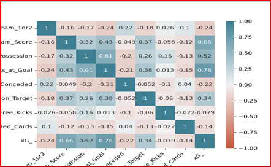
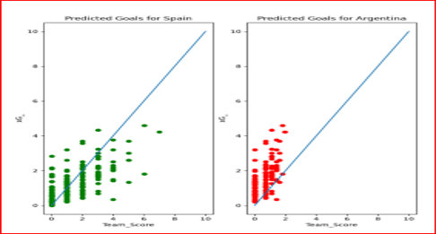
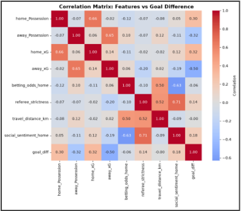
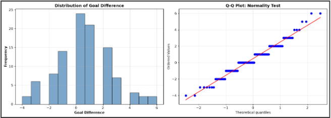
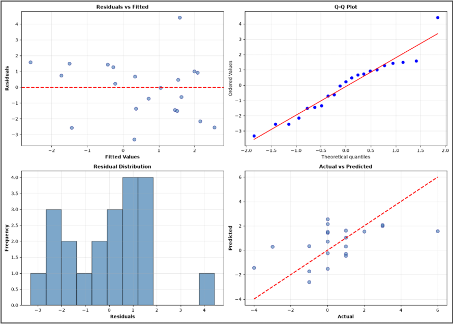
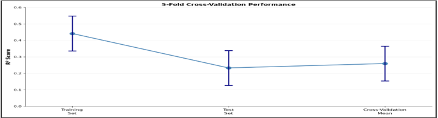

<h1>Group 23 ~ Assessment 3 </h1>
<h2>Foundations of Data Science </h2>
<h3>Charles Darwin University </h3>

<h2>Group 23:</h2>

| Name | Student # | Study Mode | Region |
|--------|----------|---------------|--------|
| Danielle | S407528 | Online | WA |
| Gabrielle | S375255 | Online | NT |
| Judith | S395778 | Online | NSW |
| Manuela | S320756 | Online | NSW |

<h2>⚽ Project Overview - FIFA World Cup Analysis</h2>

This project investigates the FIFA World Cup 2026 statistics.

## Group 23 wiki
[Take Me Home](https://github.com/DanDooLoo/HIT140_Assessment-2_Group23/wiki)

### Assessment 2: Group Presentation
[Objective 1](https://github.com/DanDooLoo/HIT140_Assessment-2_Group23/wiki/Objective-1-%E2%80%90-Group-Presentation) 
[Group 23: Objective 1 - Documentation](https://github.com/DanDooLoo/HIT140_Assessment-2_Group23/wiki/Objective-1-%E2%80%90-Group-Documentation)

### Assessment 3: Group Report
[Objective 2](https://github.com/DanDooLoo/HIT140_Assessment-2_Group23/wiki/Objective-2-%E2%80%90-Linear-Regression-Models-%E2%80%90-Question-2.1-&-2.3) 
[Group 23: Objective 2 - Documentation](https://github.com/DanDooLoo/HIT140_Assessment-2_Group23/wiki/Objective-2-%E2%80%90-Documentation)

<h2>📌 Objective 2:</h2>

<h2>Group 23: Assessment 3 - Objective 2 - Linear Regression</h2>

**🧱 Load data**
- `matches_data` = pd.read_csv('matchesk.csv')
- `external_data` = pd.read_csv('external_factors.csv')
- `teams_data` = pd.read_csv('teamsk.csv')
- `venues_data` = pd.read_csv('venuesk.csv')
- `full_data` = pd.read_csv('full.csv')

**🔗 Sources:**
- FIFA Official Website: `https://www.fifa.com/en/tournaments/mens/worldcup/canadamexicousa2026/statistics`
- FB Ref: `https://fbref.com/en/`
- Kaggle: `https://www.kaggle.com/datasets`
- Stats Don't Lie: `https://www.thestatsdontlie.com/football/world-cup-2026/`

<h2>🧪 2.1 Linear Regression</h2>

**🗺️ Stage 1: Conceptual Domains Identification**

Goal difference is determined by the interplay of three domains: 

(a) `team capability` (inherent strength and attacking prowess) 
(b) `match conditions` (venue and officiating characteristics) 
(c) `contextual factors` (travel fatigue and psychological state) 

This framework ensured comprehensive coverage of mechanisms influencing match outcomes.

**🗺️ Stage 2: Pre-Match Data Constraint**

The specification "pre-match data only" eliminates post-match statistics (shots, corners, possession during play) and retroactively calculated metrics. This constraint is critical for genuine predictive utility models must rely on information available *before* kickoff, not observed during play.

**⚙️ Stage 3: Variable Operationalisation**

| Domain | Variable | Justification | Source |
|--------|----------|---------------|--------|
| **Team Capability** | `home_Possession (%)` | Ball possession reflects team's intended tactical approach and control in play; aggregate FIFA data proxies expected possession tendency | FIFA tournament statistics |
| | `away_Possession (%)` | Symmetric away team measure; possession asymmetry (home - away) indicates control differential | FIFA tournament statistics |
| | `home_xG` | Expected Goals quantifies shot quality and finishing threat independent of actual conversion; pre-match xG based on team historical efficiency | Match external factors |
| | `away_xG` | Away team expected goals; provides balanced assessment of offensive threat | Match external factors |
| **Match Conditions** | `betting_odds_home` | Market-implied probability of home win incorporates collective expert judgment; odds compress multiple unobserved variables into single summary statistic | Pre-match betting market |
| | `referee_strictness` | Officiating bias influences goal-scoring opportunities through penalty-giving propensity and tackling tolerance; strictness rating derived from historical yellow/red card distribution | Referee profile dataset |
| **Contextual Factors** | `travel_distance_km` | Away team travel distance quantifies jet lag, sleep disruption, and recovery difficulty; non-linear fatigue effects expected | Match venue data |
| | `social_sentiment_home` | Team social media sentiment proxies psychological readiness, confidence, and squad morale pre-match; aggregate measure filters match-day noise | Social media analytics |

## 🚀 2.1 LINEAR REGRESSION MODELING RESULTS

### 🎯 4. MODEL SPECIFICATION & EVALUATION FRAMEWORK

**Model:** Ordinary Least Squares (OLS) multiple linear regression  
**Transformation:** StandardScaler normalisation (mean=0, std=1) enables direct coefficient comparison and stabilises numerical estimation  
**Validation Strategy:** 80/20 train/test split (random_state=42 for reproducibility) + 5-fold cross-validation to assess generalisation

**Results: Test/Train Multi Split Models
**2.1 by** Danielle Whitney [DW] and Manuela Crannis [MC]

| Test Size [DW] | 70% Train 30% Test | 80% Train 20% Test | 90% Train 10% Test |
|----------------|--------------|--------------|--------------|
|Intercept | 0.4526 | 0.4526 | 0.4526 |
| MAE (MLP) | 1.51168 | 1.5665 | 1.4332 |
| MSE (MLP) |3.9526 | 3.9299 | 2.6853 |
| RMSE (MLP) | 1.9881 | 1.9824 | 1.6387 |
| RMSE_Norm (MLP) | 0.9573 | 0.9497 | 0.8120 |
| R² (MLP) | 0.0541 | 0.0530 | 0.2747 |
| | | | |
| MAE (Baseline) | 1.4688 | 1.3810 | 1.5455 |
| MSE (Baseline) | 4.5313 | 4.3333 | 3.9091 |
| RMSE (Baseline)| 2.1287 | 2.0817 | 1.9771 |
| RMSE_Norm (Baseline) | 1.0249 | 0.9973 | 0.9797 |
| R² (Baseline) | -0.0844 | -0.0443 | -0.0558 |

| Test Size [MC] | 70% Train 30% Test | 80% Train 20% Test | 90% Train 10% Test |
|----------------|-----------------------|-----------------------|-----------------------|
| Intercept | -0.1074 | -0.1186 | -0.1273 |
| MAE (MLP) | 1.4307 | 1.4494 | 1.4741 |
| MSE (MLP) | 3.178 | 3.1061 | 3.0259 |
| RMSE (MLP) | 1.7827 | 1.7624 | 1.7395 |
| RMSE_Norm (MLP) | 0.936 | 0.9283 | 0.9034 |
| R² (MLP) | 0.1202 | 0.1328 | 0.1735 |
| | | | |
| MAE (Baseline) | 1.578 | 1.5941 | 1.6657 |
| MSE (Baseline) | 3.6384 | 3.5866 | 3.6695 |
| RMSE (Baseline) |	1.9075 | 1.8938 | 1.9156 |
| RMSE_Norm (Baseline) | 1.0015 | 0.9975 | 0.9949 |
| R² (Baseline) | -0.0073 | -0.0013 | -0.0023 |

### 💡 5. RESULTS INTERPRETATION
## Figure 1: Objective 2.1 Results Obtained using Heat Maps and Scatterplots by Manuela Crannis

## Figure 2: Objective 2.1 Visulisations by Danielle Whitney

## 2.2 Linear Regression: 

| Test Size | 70% Train 30% Test | 80% Train 20% Test | 90% Train 10% Test |
|-----------|-----------------------|-----------------------|-----------------------|
| Intercept | x | x | x |
| MAE (MLP) | x | x | x |
| MSE (MLP) | x | x | x |
| RMSE (MLP) | x | x | x |
| RMSE_Norm (MLP) | x | x | x |
| R² (MLP) | x | x | x |
| | | | |
| MAE (Baseline) | x | x | x |
MSE (Baseline) | x | x | x |
RMSE (Baseline) | x | x | x |
RMSE_Norm (Baseline) | x | x | x |
R² (Baseline) | x | x | x |
			
## Figure 2: Objective 2.2 Visulisations by XXXX
......

## 7. Conclusions & Interpretive Synthesis

### Key Findings:
1. Variable Selection was Well-Motivated: The 8-variable specification balances conceptual coverage (team capability, match conditions, contextual factors) with parsimony appropriate for n=104. Each variable addresses a theoretically distinct mechanism influencing goal difference.

2. Group 23  used a training / test model of 70%, 80%, 90% to test our models to determine if the explanatory variables we selected were appropriate for this task. We also calculated the mean absolute error, mean squared error, root mean square error, and normalised root mean square error and compared them with a baseline.

3. For further clarification our group also compared our results with the actual result of the grand final match between Argentina and Spain versus the predicted result for both Linear Regression Models 2.1 and 2.2. Our results can be viewed using the link provided to our repository in GitHub, Group 23 – Assessment 3 – Objective 2. 

Author: Danielle Whitney + Gabby Davis
